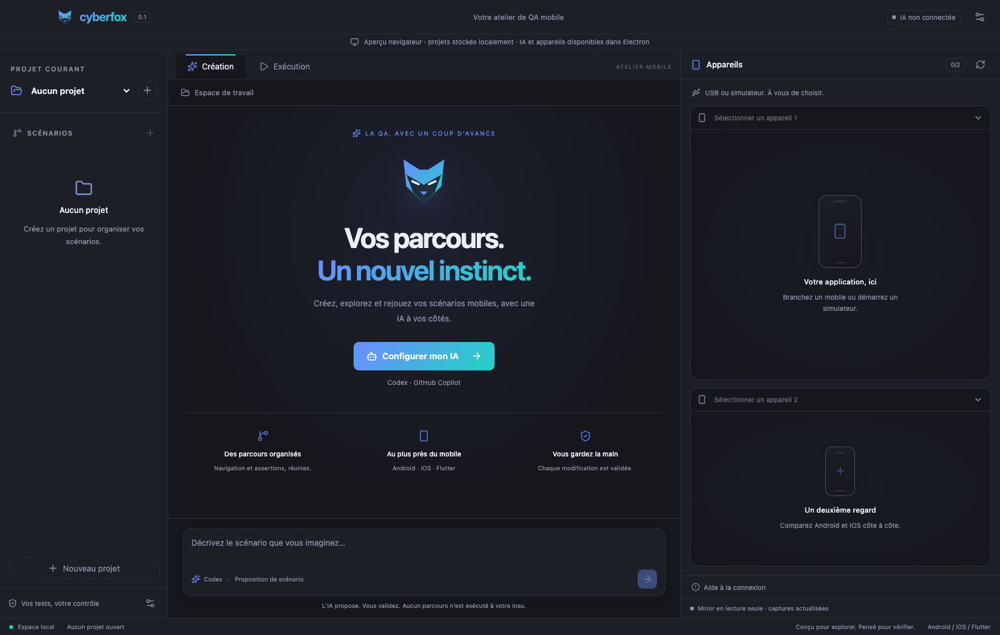

# Cyberfox

Atelier QA mobile en Electron, React et TypeScript. Interface et six palettes reprises de Cyberdog : clair, sombre, Midnight, Dracula, forêt, Sunset, avec mode système et français/anglais.



## Développement

Node.js 22.12+ (ou version LTS plus récente) et npm.

```sh
npm ci
npm run dev
```

L’interface est aussi accessible sur http://127.0.0.1:5173. `npm run dev:web` lance uniquement l’aperçu navigateur : son stockage local est distinct du stockage Electron, les connexions IA et USB n’y sont pas simulées comme fonctionnelles.

```sh
npm run build
npm start
npm test
npx playwright install chromium
npm run test:e2e
npm run test:electron
```

`npm run dist` prépare un installateur de développement non signé pour la plateforme courante. Les runtimes natifs Codex et Copilot sont décompressés hors de l’archive ASAR. Une signature et la notarisation restent à préparer avant une distribution publique.

## Fonctionnement disponible

- Création de projets Android, iOS et/ou Flutter ; un seul projet courant.
- Un dossier par projet, contenant `cyberfox.project.json` : arbre navigation/test/assertion/groupe, descriptions, historique IA et onglet courant.
- Répertoire de création configurable dans Paramètres → Projets. Changer ce répertoire ne déplace pas les anciens projets.
- Arbre repliable, création manuelle de nœuds et enfants, chemin cliquable.
- Création et Exécution, onglet mémorisé indépendamment pour chaque projet.
- Paramètres à onglets, thèmes et langue persistants.
- Connexion Codex ou GitHub Copilot via les CLI officielles incluses et réutilisation des sessions locales existantes.
- Modèle configurable : modèles du compte Copilot ; catalogue Codex local si disponible, ou identifiant saisi manuellement. Un champ vide utilise le choix par défaut du fournisseur.
- Demandes IA contextualisées par le projet, le scénario sélectionné, les échanges précédents et les captures des appareils sélectionnés. Les captures et demandes quittent le poste vers le fournisseur choisi.
- Propositions de scénarios validées et ajoutées après accord. Les scénarios existants restent inchangés.
- Détection Android USB/émulateurs, simulateurs iOS et iPhone USB. Deux vues mobiles au maximum, filtrées selon le projet ; deux vues ouvertes s’affichent côte à côte.
- Miroir en lecture seule par captures PNG périodiques (environ une capture toutes les 1,5 secondes, plus le temps de capture), avec pause et gestion des déconnexions.

Flutter décrit la technologie. Un projet Flutter seul autorise les deux OS ; si Android/iOS sont cochés, ces choix limitent les appareils proposés.

## Préparation des appareils

### Android

Installer Android SDK Platform Tools ; `adb` doit être accessible. Cyberfox recherche aussi dans les emplacements SDK standards du compte utilisateur. Activer le débogage USB et accepter l’autorisation sur le téléphone. Les émulateurs déjà démarrés sont découverts via ADB.

### iOS Simulator

macOS et Xcode avec un runtime iOS. Démarrer le simulateur via Xcode/Simulator avant de le sélectionner ; les simulateurs arrêtés sont listés avec un état indisponible. Le build destiné au simulateur doit être installé séparément.

### iPhone USB

Installer `libimobiledevice` (`idevice_id`, `idevicename`). Accepter la confiance et activer le mode développeur. Préparer, signer et lancer WebDriverAgent avec Xcode/Appium, puis exposer son port par un tunnel local. Régler son URL et l’UDID associé dans Paramètres → Appareils. Dans les paramètres, associer explicitement ce tunnel à l’UDID de l’iPhone (visible dans la description de l’appareil). WDA ne fournit pas cet identifiant dans son statut : cette association doit être correcte pour afficher le bon écran. L’installation/signature automatique de WDA n’est pas encore prise en charge.

## Connexion IA

Paramètres → Intégration IA → choisir Codex ou Copilot → Connecter mon compte. Le navigateur officiel s’ouvre et les instructions/code s’affichent dans les paramètres. Après connexion, cliquer sur Vérifier puis Enregistrer. Les CLI conservent leurs identifiants selon leurs propres règles ; Cyberfox ne copie aucun jeton dans ses fichiers de projet ou ses paramètres. Les sessions sont partagées avec vos outils CLI locaux.

L’accès dépend de votre offre et des politiques de votre organisation. L’usage IA consomme les quotas/crédits du fournisseur. Le statut et la liste des modèles n’exécutent aucun prompt payant de test.

Sources officielles : [Codex SDK](https://learn.chatgpt.com/docs/codex-sdk), [authentification Codex](https://learn.chatgpt.com/docs/auth), [Copilot SDK](https://github.com/github/copilot-sdk), [authentification Copilot](https://docs.github.com/en/copilot/how-tos/copilot-sdk/auth/authenticate).

## Limites explicites de la première base

Le moteur de rejeu Appium, les actions sur téléphone, les sélecteurs exécutables et le workflow d’analyse des échecs ne sont pas encore implémentés. L’onglet Exécution le signale : aucun résultat de test n’est inventé. L’IA reçoit les captures sélectionnées mais ne dispose d’aucun outil de pilotage ; les scénarios proposés sont des brouillons descriptifs.

Le workflow prévu sur échec est : conserver les preuves et le résultat original, analyser avec l’IA, proposer une correction révisable dans une popup, continuer les tests indépendants, joindre l’analyse au rapport final. Toute correction donnera une nouvelle révision sans écraser l’échec initial.

Le proxy réseau, les installateurs signés, les tests sur vrais appareils et la validation de bout en bout avec un compte IA restent des étapes distinctes. Les tests automatisés ne prétendent pas couvrir du matériel absent.

## Structure

- `src/` : interface React et aperçu navigateur.
- `shared/model.ts` : contrats et validation Zod.
- `electron/store.ts` : projets et réglages, écritures atomiques sérialisées.
- `electron/devices.ts` : détection et captures.
- `electron/ai.ts` : adaptateurs SDK officiels et propositions.
- `electron/preload.cts` : pont IPC limité ; pas de Node.js dans l’interface.
- `tests/` : persistance, validation, parsing ADB et parcours UI.

La configuration globale est dans le répertoire utilisateur Electron `Cyberfox` (nom d’application `cyberfox` selon la plateforme). `CYBERFOX_USER_DATA` permet d’isoler les données lors des tests.
