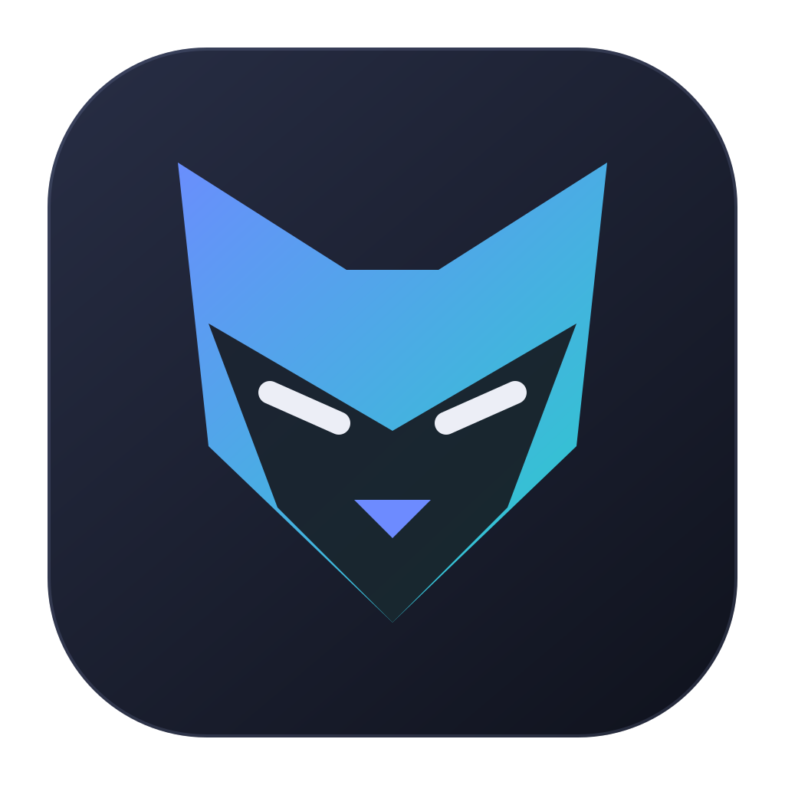
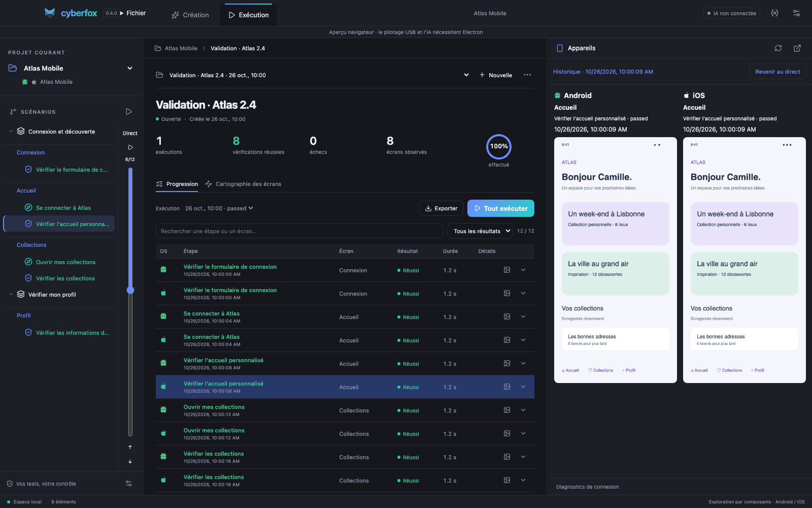
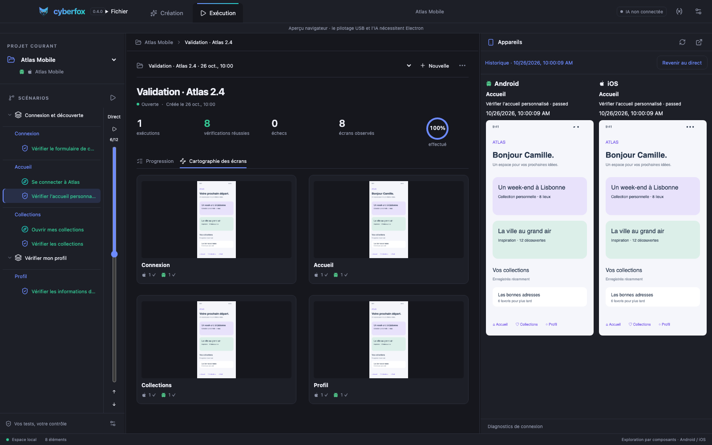
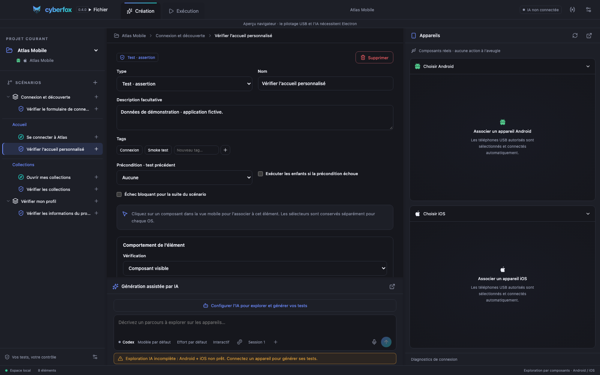

<div align="center">
  
  <h1>Cyberfox</h1>
  <p><strong>Your mobile tests. With proof built in.</strong></p>
  <p>An open-source desktop workspace to explore, create and replay Android & iOS test scenarios.</p>
  <p><a href="README.fr.md">Français</a> · <strong>English</strong></p>
  <p>
    <a href="https://pickywawa.github.io/cyberfox/">Website</a> ·
    <a href="https://github.com/pickywawa/cyberfox/releases/latest">Download</a> ·
    <a href="https://github.com/pickywawa/cyberfox/blob/main/CHANGELOG.md">What’s new</a> ·
    <a href="https://github.com/pickywawa/cyberfox/issues">Report an issue</a>
  </p>
  <p>
    <a href="https://github.com/pickywawa/cyberfox/releases/latest"></a>
    <a href="https://github.com/pickywawa/cyberfox/actions/workflows/ci.yml"></a>
    <a href="LICENSE"></a>
  </p>
</div>



_Actual Cyberfox browser-preview screenshots. Atlas Mobile is a fictional app; all displayed results and mobile screens are demonstration data._

## One journey. Two platforms. Evidence at every step.

Cyberfox brings the scenario tree, test results and devices into one resizable workspace. Build scenarios manually or let Codex / GitHub Copilot explore connected devices and propose additions for your review. Run campaigns, revisit screenshots and share the results.

| Explore                                                     | Create                                                   | Verify                                               |
| ----------------------------------------------------------- | -------------------------------------------------------- | ---------------------------------------------------- |
| Inspect accessible UI components on Android and iOS.        | Describe a journey or bind components to steps yourself. | Run scenarios and check observable outcomes.         |
| Interactions use element selectors, not screen coordinates. | Shared intent, separate operations and selectors per OS. | A successful tap is not treated as proof of success. |

## Inside the workspace

### Campaigns that keep the context

- Persistent campaign history and per-platform results.
- Compact progress table with search, status filters and a completion ring.
- Select a step to display its screenshot in the device panel.
- Expand step details without opening a screenshot inside the table.
- Export the whole campaign as **text, CSV, Markdown or Confluence wiki markup**.
- When rerunning all tests, choose whether to retain results or clear the current campaign and restart the app. Restarting preserves app data.

### A map of what you tested



Only screens associated with executed tests appear. View available captures, observed paths and small Android/iOS counters. Click a screen to open its test details in a contextual popup.

### Assisted creation, with review built in



- **Codex or GitHub Copilot**, with model and reasoning-effort selection.
- **Interactive / Auto-approve** exploration modes. Auto-approve handles clarification and supplied-variable creation without popups; it does not bypass final proposal review.
- Project variables referenced as `${VARIABLE_NAME}` in scenarios.
- Newly supplied credentials can be saved during exploration and used immediately.
- Validation against observed selectors and successfully executed interactions; bounded correction of incomplete proposals.
- Optional replay before acceptance, distinct screen identities, preconditions and blocking steps.
- Local exploration traces and per-OS coverage gaps when a device is unavailable.

## Download

**[Download Cyberfox 0.4.0 for macOS Apple Silicon](https://github.com/pickywawa/cyberfox/releases/download/v0.4.0/Cyberfox-0.4.0-mac-arm64.dmg)**

Open the DMG, then drag **Cyberfox** into **Applications**. See the [release notes](https://github.com/pickywawa/cyberfox/releases/tag/v0.4.0) for checksums and details.

The macOS app is locally ad-hoc signed, without Apple Developer ID signing or notarization. macOS may require approval in **System Settings → Privacy & Security → Open Anyway** after an initial launch attempt. Projects and settings remain in their existing locations when upgrading.

Only the macOS Apple Silicon installer is published for this release. Windows, Linux and Intel development builds can be produced from source; they are not downloadable installers in this release. Built-in updates detect later stable GitHub releases and let you download their installer.

## Device setup

| Target  | Requirements                                                                                                                                                           |
| ------- | ---------------------------------------------------------------------------------------------------------------------------------------------------------------------- |
| Android | Android SDK Platform Tools, a JDK, USB debugging and an authorized device; booted emulators can also be selected.                                                      |
| iOS     | Standard setup: macOS, Xcode and WebDriverAgent. Physical iPhones require trust, Developer Mode and signing for the WDA runner. Boot simulators before selecting them. |
| Flutter | Accessible controls exposed to Appium. Flutter projects target both Android and iOS; each platform keeps its own selectors.                                            |

Appium, UiAutomator2 and XCUITest are bundled. A detected device does not automatically mean automation is ready: the device-panel diagnostics distinguish connection, signing, WDA and mirror status. Accessibility quality and stable application identifiers still matter.

## Data and AI

Projects, variables, captures and campaign results are stored on your machine. AI exploration and analysis send the relevant request and UI context to the selected provider using your authenticated account. Provider usage limits and terms apply; no Cyberfox account is required.

Scenarios store variable placeholders instead of credential literals. Project variables are local project data, **not an encrypted password vault**. Keep project folders and exported artifacts private when they contain sensitive data. This repository and its screenshots contain demonstration data only.

## Development

Node.js **22.12+** and npm:

```sh
git clone https://github.com/pickywawa/cyberfox.git
cd cyberfox
npm ci
npm run dev
```

| Command                             | Purpose                                                                                  |
| ----------------------------------- | ---------------------------------------------------------------------------------------- |
| `npm run dev`                       | Vite + TypeScript watch + Electron with automatic backend restart.                       |
| `npm run dev:web`                   | Browser preview with separate local storage; no device control or real AI.               |
| `npm run build`                     | Type-check and build the application.                                                    |
| `npm test`                          | Unit, protocol and persistence tests.                                                    |
| `npm run test:e2e`                  | Playwright browser tests; install Chromium first with `npx playwright install chromium`. |
| `npm run test:electron`             | Desktop smoke tests in an isolated profile.                                              |
| `npm run dist -- --mac dmg --arm64` | Build the Apple Silicon installer on macOS.                                              |
| `npm run test:package:mac`          | Check packaged app integrity, signature and icons.                                       |
| `npm run test:package:appium`       | Load bundled drivers and start the packaged Appium server.                               |

Use `CYBERFOX_USER_DATA=/absolute/path/to/dev-profile npm run dev` for an isolated desktop profile. The browser preview uses its own storage. The [static website](site/) deploys to GitHub Pages using [its workflow](.github/workflows/pages.yml).

Additional documentation (French): [creation assistance](docs/creation-assistance.md), [test campaigns](docs/test-campaigns.md), [technical reference](docs/development.md).

## Contributing

Bug reports should include the Cyberfox version, host OS, target OS, relevant step and a sanitized error or trace. Avoid posting credentials, personal information or real business screenshots. See [open issues](https://github.com/pickywawa/cyberfox/issues).

Built with Electron, React, TypeScript, Appium, Codex and GitHub Copilot integrations. Part of the same family as [Cyberdog](https://pickywawa.github.io/cyberdog/).

[MIT](LICENSE) · © 2026 pickywawa
